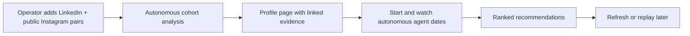
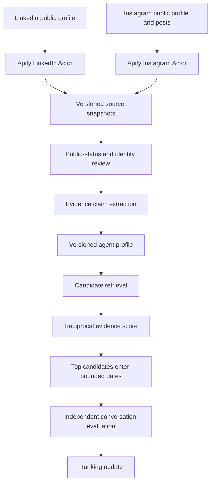

# Product and agent flow

## What the user sees

The profile page comes before rankings. Each card distinguishes an observed public fact from an unknown. A date is visibly a simulation between agents; neither agent claims to be the human.

## What the system does

The two agents each receive only their own person's source-backed profile and the shared transcript. The evaluator is separate from the speakers. Source snapshots, derived claims, simulated dialogue, and ranking results live in separate tables, so conversation text cannot silently become a biographical fact.

## Matching stages

1. **Eligibility.** Both required profiles must be public and analyzed. Name disagreement goes to curator review. A production service must also require member consent and first-party match preferences; social media does not reliably establish dating intent.
2. **Retrieve.** For the 25-person demo, compare every ready person so each gets a complete 24-person ranking. Above 200 people, SQLite FTS5 returns a bounded candidate set. A production deployment should use a vector ANN index plus structured eligibility filters.
3. **Score both directions.** Evidence claims are tokenized and weighted by category and confidence. `A → B` measures how much of A's supported themes B covers. `B → A` measures the reverse. Their harmonic mean contributes to the score, while the owner-direction score preserves a personal ordering. Work claims carry less weight than stated hobbies, interests, values, or needs.
4. **Date selectively.** A greedy bounded edge cover chooses pairs so every ready agent goes on at least one date. Run an eight-turn, phase-bounded date per chosen pair in a background cohort job. Save every turn and the two profile versions used. An independent evaluator rates conversational quality, grounding, and acknowledged unknowns. The date contributes a small bounded ranking adjustment; it is not treated as a real romantic outcome.
5. **Invalidate incrementally.** Source content changes create a new profile version and increment a cohort version. Rankings recompute lazily when viewed. Old dates remain replayable but do not adjust scores for a newly changed profile.

## Refresh policy

| Cohort | Source check interval |
|---|---:|
| All profiles in this operator-run POC | 1 day |

Each source has its own due date. A source check updates `last_checked_at`. A meaningful content change creates a new snapshot and triggers analysis. Failed scrapes retry after six hours. The operator can force a refresh from a profile page.

## Data boundaries

- Exactly two outside sources contribute facts about a person: the LinkedIn profile and public Instagram profile/posts.
- The normalized snapshot keeps useful public text and canonical post URLs. It omits contacts, follower counts, media files, and extra linked websites.
- A claim stores a category, concise text, evidence key, and confidence. The evidence key resolves to a source excerpt and URL from the exact snapshots used by that profile version.
- Relationship intent, orientation, age, health, religion, and intimate needs are not inferred from public content. A need is recorded only when explicitly stated. This necessarily leaves many profiles incomplete.
- Deleting a person should cascade through snapshots, profiles, dates, and rankings in a production data-retention workflow; access control, consent, and deletion UI are not implemented in this prototype.

## Demo delivery gate

The three-minute video must be recorded from a populated, working app. Before recording: verify 25 distinct real people and both official URLs for each, confirm Instagram public status via a live source check, inspect identity review decisions, run the profile analyzer, generate rankings, and save multiple live agent dates. A replay can then show one date in full while still proving it was created by the app. No unverified candidates or rule-based fallback runs should be passed off as a live model demonstration.
